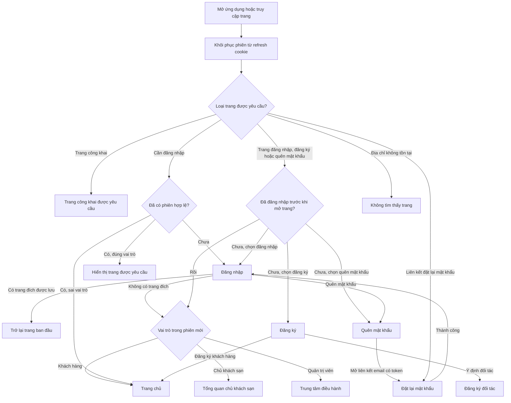
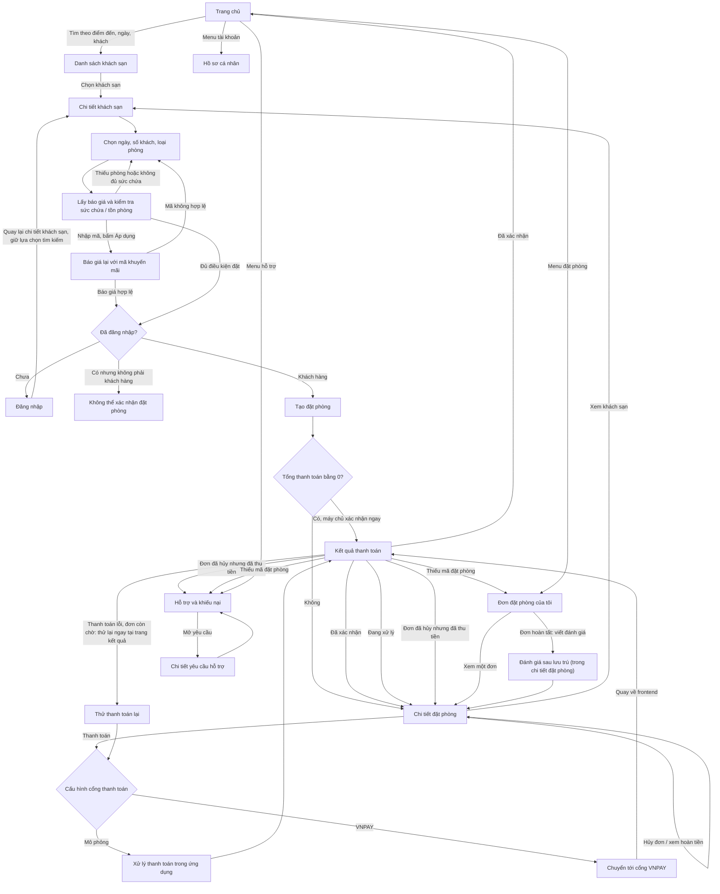
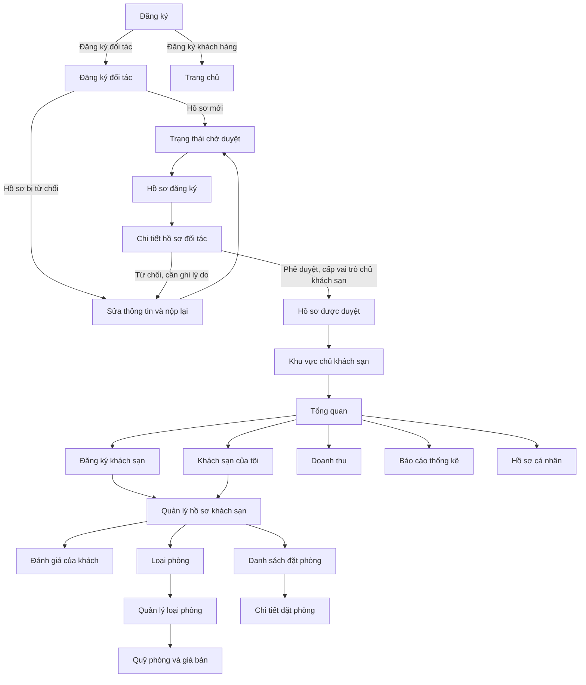
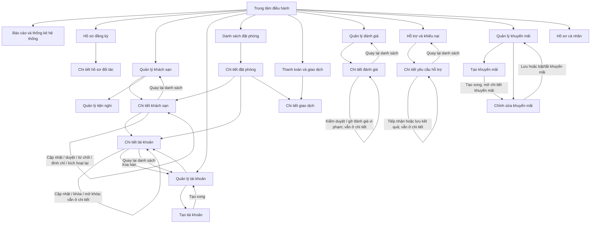

# Sơ đồ luân chuyển trang frontend Egode

Mã Mermaid thuần nằm trong [frontend-page-flow.mmd](frontend-page-flow.mmd), bắt đầu bằng `graph TD;` và dùng dấu `;` sau mỗi câu lệnh. Để tạo sơ đồ trong draw.io, sao chép toàn bộ nội dung file `.mmd` vào **Arrange → Insert → Mermaid**, rồi chọn **Insert**. File `.drawio` dùng định dạng XML và lưu mã Mermaid bên trong từng nhóm sơ đồ.

Tài liệu này mô tả route và các luồng điều hướng/ xử lý chính theo mã nguồn hiện tại trong `frontend/src/routes`, `frontend/src/pages` và các component điều hướng liên quan.

## Phạm vi đếm trang

Route chính có **51 mục**: 50 path cụ thể trong bốn nhóm và route `*` cho trang không tìm thấy. Mục `/owner` là route chuyển hướng tới `/owner/overview`. Một component có thể phục vụ nhiều path hoặc nhiều chế độ hiển thị; các URL cũ trong `aliases.tsx` và `OwnerRouteRedirects.tsx` cũng chuyển về route chuẩn nên không tạo màn hình nghiệp vụ mới.

| Khu vực | Số mục | Route |
|---|---:|---|
| Công khai / xác thực | 7 | `/`, `/login`, `/register`, `/forgot-password`, `/reset-password`, `/hotels`, `/hotels/:id` |
| Khách hàng | 7 | `/profile`, `/partner/apply`, `/bookings`, `/bookings/:id`, `/payment/result`, `/support`, `/support/:id` |
| Chủ khách sạn | 14 | `/owner`, `/owner/overview`, `/owner/hotels`, `/owner/hotels/new`, `/owner/hotels/:hotelId`, `/owner/hotels/:hotelId/reviews`, `/owner/room-types`, `/owner/room-types/:roomTypeId`, `/owner/inventory-pricing`, `/owner/bookings`, `/owner/bookings/:bookingId`, `/owner/revenue`, `/owner/reports`, `/owner/profile` |
| Quản trị viên | 22 | `/admin`, `/admin/profile`, `/admin/accounts`, `/admin/accounts/new`, `/admin/accounts/:id`, `/admin/hotels`, `/admin/hotels/amenities`, `/admin/hotels/:id`, `/admin/bookings`, `/admin/bookings/:id`, `/admin/payments`, `/admin/payments/:id`, `/admin/reviews`, `/admin/reviews/:id`, `/admin/support`, `/admin/support/:id`, `/admin/partner-applications`, `/admin/partner-applications/:id`, `/admin/analytics`, `/admin/promotions`, `/admin/promotions/new`, `/admin/promotions/:id` |
| Không tìm thấy | 1 | `*` |
| **Tổng** | **51** | |

## Điều hướng chung và xác thực

`ProtectedRoute` giữ URL đích trong `state.from` để trang đăng nhập quay lại sau khi xác thực. Nếu không có URL đích, trang đích sau đăng nhập dựa trên vai trò. Các route admin chỉ cho vai trò quản trị viên; các route owner chỉ cho vai trò chủ khách sạn. Backend tiếp tục xác thực quyền trên từng API.

## Luồng tìm kiếm, đặt phòng và hỗ trợ khách hàng

Các bước báo giá, chọn phòng, nhập khuyến mãi, tạo đơn, thanh toán và đánh giá được xử lý ngay trong các trang hiện có; frontend không có route riêng cho từng bước checkout hay trang viết đánh giá. Kết quả thanh toán được xác định lại bằng trạng thái đơn và giao dịch tải từ API. Chỉ đơn đang chờ thanh toán mới hiện thao tác thử thanh toán lại; đánh giá chỉ mở khi đơn hoàn tất. Hủy đơn/hoàn tiền giữ người dùng ở trang chi tiết đơn.

`/support` vừa chứa lịch sử vừa mở form tạo yêu cầu. Khi gửi thành công, form đóng và danh sách được cập nhật; chọn một yêu cầu sẽ mở `/support/:id`. Phản hồi xử lý của admin hiển thị ở trang chi tiết này.

## Đăng ký đối tác và khu vực chủ khách sạn

Sau đăng ký với ý định đối tác, tài khoản được tạo trước ở vai trò khách hàng rồi chuyển tới form hồ sơ. Frontend bật khóa điều hướng trong phiên này cho tới khi nộp hồ sơ hoặc đăng xuất; hồ sơ đang chờ duyệt bị giới hạn một số tính năng khách hàng. Hồ sơ bị từ chối có thể nộp lại. Phê duyệt hồ sơ cấp quyền chủ khách sạn; chủ khách sạn sau đó có thể đăng ký khách sạn và quản lý phòng, giá/tồn phòng, đặt phòng và báo cáo.

Owner sidebar giữ `hotelId` trong query string cho các module cần ngữ cảnh khách sạn. Các trang quản lý khách sạn, loại phòng và chi tiết đặt phòng cũng nối trực tiếp tới những module liên quan. `/owner` là lối vào tương thích và chuyển về `/owner/overview`.

## Khu vực quản trị viên

Dashboard admin là điểm vào các nhóm vận hành và các hàng đợi hồ sơ đối tác, hỗ trợ và đánh giá. Danh sách dẫn tới trang chi tiết; chi tiết booking có liên kết chéo sang khách sạn, tài khoản và giao dịch. Tạo khuyến mãi chuyển sang URL `:id` sau khi tạo. Tiện nghi được mở từ danh sách khách sạn.

## Alias tương thích

Các URL cũ được giữ để bookmark/liên kết cũ vẫn hoạt động, sau đó chuyển tới route chuẩn bằng replace. Ví dụ: `/home` → `/`, `/search-results` → `/hotels`, `/hotel-detail/:id` → `/hotels/:id`, `/my-bookings` → `/bookings`, `/payment-result` → `/payment/result`, `/admin/operations` → `/admin`. Các URL cũ cho bước phòng/xác nhận/thanh toán của booking chuyển tới `/bookings/:id`; URL viết đánh giá chuyển tới `/bookings/:id#danh-gia`. Alias owner/partner giữ ID khách sạn và tham số ngữ cảnh khi điều hướng về `/owner/...`.

## File nguồn chính

- Route tổng và route nhóm: `frontend/src/routes/AppRoutes.tsx`, `publicRoutes.tsx`, `customerRoutes.tsx`, `ownerRoutes.tsx`, `adminRoutes.tsx`.
- Kiểm soát đăng nhập và vai trò: `frontend/src/components/auth/ProtectedRoute.tsx`, `GuestOnlyRoute.tsx`, `frontend/src/lib/roles.ts`.
- Điều hướng theo vai trò: `frontend/src/components/common/Navbar.tsx`, `frontend/src/components/layouts/DashboardNavigation.tsx`.
- Đặt phòng/thanh toán: `frontend/src/pages/public/HotelDetailPage.tsx`, `frontend/src/pages/customer/BookingDetailPage.tsx`, `PaymentResultPage.tsx`, `frontend/src/features/payments/usePaymentFlow.tsx`.
- Đăng ký đối tác: `frontend/src/pages/customer/PartnerApplyPage.tsx`, `frontend/src/pages/admin/AdminPartnerApplicationDetailPage.tsx`.
